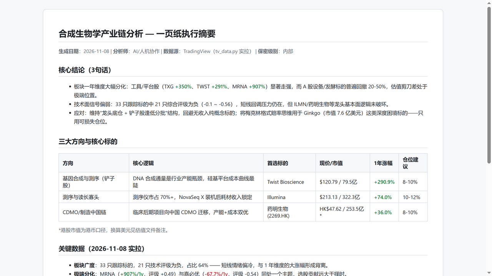

# Investment Skill — Investment-bank-grade industry research, generated by AI

[中文文档](./README.md)

**In one sentence**: give your AI agent a modular equity-research framework (17 pluggable analysis modules × 5 report depths × 4 writing styles), and it will produce a full industry-chain research report — from supply-chain decomposition to portfolio construction — with market data fetched automatically and the methodology improving through backtesting.



## What it answers

- "Which picks-and-shovels plays matter on this industry chain?" → module 03 (chain decomposition) + 04 (shovel screening)
- "How wide is this company's moat, really?" → module 05 (Morningstar-style moat rating)
- "Which catalysts should I watch next quarter?" → module 06 (catalyst calendar)
- "Did the market buy the thesis I wrote last quarter?" → module 12 (forecast-vs-actual backtest)

## Quick start (60 seconds)

```bash
git clone git@github.com:ILFISHDEER/claude-investment-skill.git && cd claude-investment-skill
pip install yfinance pyyaml requests
python tv_data.py 合成生物学        # fetch live quotes via TradingView's public scanner (no API key)
# alternative: python update_data.py 合成生物学   # Yahoo Finance source
```

Then ask your AI agent (Claude Code or any agent that can read this repo):

> Generate an investment research report according to config.yaml

Or run the skeleton generator directly: `python generate_report_v2.py --theme 合成生物学`

## How it works

- **Content and data are separated.** `themes/<theme>/data/` holds refreshable market data (YAML); `modules/` holds the analysis methodology. Data refreshes weekly, methodology iterates quarterly.
- **Depth is a dial, not a rewrite.** The same theme renders as L0 (one sentence) → L4 (100+ page handbook) from the same modules.
- **The system grades itself.** Every quarter, `maintenance.py` scores the stock pool on 6 dimensions (price / valuation / financials / technology / catalyst / risk) and forces out anything below 60 — the framework backtests its own predictions.

## Notes

- Deep documentation (architecture, stock-pool rules, backtesting) is currently **in Chinese** — see [README.md](./README.md) and `SYSTEM_ARCHITECTURE.md`.
- The TradingView connector uses a public, unofficial endpoint: fine for personal research, not a production data feed. Yahoo Finance is the primary source.
- Sample output: [examples/demo-L1-合成生物学.md](examples/demo-L1-合成生物学.md) (real data, fetched 2026-11-08).

## License

MIT
