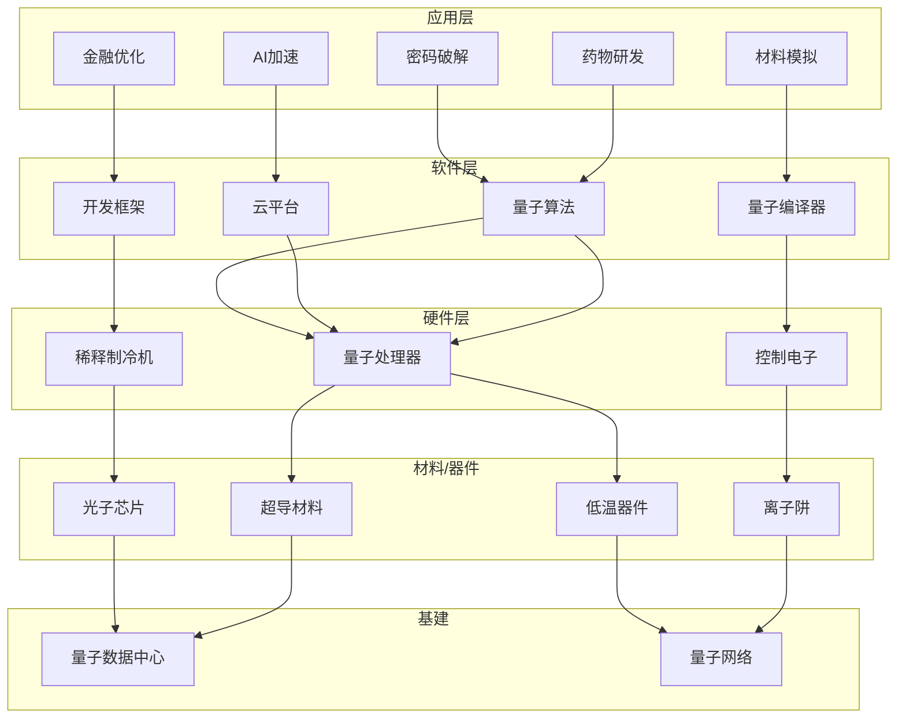

# 量子计算 — 产业链拆解

## 一句话定位
> 从实验室走向商用的下一代算力底座。短期看NISQ（含噪声中等规模量子）应用落地，长期看容错量子计算的算力跃迁。

---

## 美国篇

### 一阶（终端产品：量子计算机整机）

| 公司 | 股票代码 | 上市状态 | 技术路线 | 量子比特数 | 里程碑 |
|------|---------|---------|---------|-----------|--------|
| IBM | IBM | 上市 | 超导量子比特 | 1000+ (Condor) | System Two上线 |
| 谷歌 | GOOGL | 上市 | 超导量子比特 | 105 | Willow纠错突破 |
| IonQ | IONQ | 上市 | 离子阱 | 64 | 首个纯量子计算上市公司 |
| Rigetti | RGTI | 上市 | 超导 | 84 | 量子云服务 |
| D-Wave | QBTS | 上市 | 量子退火 | 5000+ | 优化问题专用 |

**核心判断**：IBM和谷歌走的是通用量子计算路线（门型量子计算），IonQ/Rigetti是量子云服务商业模式，D-Wave专注量子退火（优化问题）。

### 二阶（核心系统：控制电子、稀释制冷机）

| 公司 | 股票代码 | 产品 | 地位 |
|------|---------|------|------|
| FormFactor | FORM | 探针卡/测试系统 | 量子芯片测试 |
| BlueFors | 私有 | 稀释制冷机 | 量子比特环境（-273℃）|
| Janis | 私有 | 低温系统 | 美国老牌 |

**铲子股逻辑**：稀释制冷机是量子计算机的"空调"，每台价值50-200万美元，一台量子计算机需要1-4台。

### 三阶（铲子股：材料、特殊器件）

| 类别 | 公司 | 代码 | 产品 |
|------|------|------|------|
| 超导材料 | 西部超导 | 688122.SS | NbTi/Nb3Sn线材 |
| 特殊材料 | ATLANTIC | ATLA | 高纯材料 |
| 控制芯片 | 英伟达 | NVDA | CUDA Quantum |
| 低温器件 | FormFactor | FORM | 低温探针 |

### 四阶（基础设施：量子数据中心、量子网络）

| 项目 | 公司 | 状态 |
|------|------|------|
| IBM Quantum Network | IBM | 运营中，全球接入 |
| Google Quantum AI | GOOGL | 云端访问 |
| AWS Braket | AMZN | 云平台 |
| Azure Quantum | MSFT | 混合量子-经典 |

---

## 中国篇

### 一阶（整机/核心系统）

| 公司 | 股票代码 | 技术路线 | 进展 |
|------|---------|---------|------|
| 国盾量子 | 688027.SS | 量子通信+计算 | 祖冲之号合作 |
| 本源量子 | 未上市 | 超导+半导体 | 24量子比特 |
| 北京量子院 | 未上市 | 超导 | "天衍" 136比特 |
| 中科院体系 | 未上市 | 多路线 | 祖冲之号 |

**核心判断**：中国量子计算以科研院所主导（中科院、中科大），商业化公司较少。国盾量子是上市公司中唯一量子计算标的。

### 二阶（关键器件）

| 公司 | 代码 | 产品 | 地位 |
|------|------|------|------|
| 中科酷源 | 未上市 | 稀释制冷机 | 国产替代 |
| 国盾量子 | 688027.SS | 极低温器件 | 部分自研 |

### 三阶（材料/上游）

| 公司 | 代码 | 产品 |
|------|------|------|
| 西部超导 | 688122.SS | 超导材料 |
| 永鼎股份 | 600105.SS | 超导材料 |

### 四阶（基础设施）

| 项目 | 主体 | 进展 |
|------|------|------|
| 量子通信"京沪干线" | 国盾量子 | 已建成 |
| 国家量子实验室 | 中科院 | 多地布局 |

---

## 技术路线图

```
2024-2025：NISQ时代应用探索
    ├── 量子优势演示（特定问题）
    ├── 量子-经典混合算法成熟
    └── 错误缓解技术实用化

2026-2028：早期商业应用
    ├── 量子模拟（材料/药物）
    ├── 优化问题（金融/物流）
    └── 机器学习加速

2029-2035：容错量子计算
    ├── 逻辑量子比特>1000
    ├── 通用量子算法
    └── 密码学影响显现（RSA破解风险）
```

---

## 产业链图谱



---

## 跨方向协同

| 方向 | 协同点 | 受益标的 |
|------|--------|---------|
| 量子计算 × AI | 量子机器学习、量子神经网络加速 | 英伟达(NVDA)、谷歌(GOOGL) |
| 量子计算 × 能源 | 材料模拟（电池/核聚变）、电网优化 | IBM、国盾量子 |
| 量子计算 × 太空 | 量子通信卫星、量子导航 | 国盾量子、中国卫星 |
| 量子计算 × 存储 | 量子存储器、量子加密存储 | 国盾量子 |

---

## 孙哥视角

**投资逻辑**：
1. **短期（1-3年）**：关注量子云服务收入（IonQ、Rigetti）、量子优化应用落地
2. **中期（3-5年）**：容错量子计算突破，关注错误纠正技术
3. **长期（5-10年）**：通用量子计算成熟，密码学重构

**铲子股优先**：稀释制冷机、超导材料、控制电子 —— 无论谁家量子计算机胜出，这些都需要

**中美差异**：美国有纯量子计算上市公司（IONQ、RGTI、QBTS），中国主要靠科研院所+国盾量子。美股机会更多，A股更稀缺。
