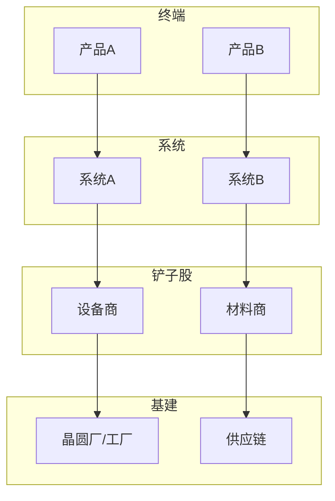

# 产业链全景拆解

## 方向一：[方向名称] — [一句话定位]

### 美国篇

#### 一阶（终端产品）
| 公司 | 股票代码 | 上市状态 | 市值 | 营收(TTM) | 毛利率 | 技术路线 |
|------|---------|---------|------|----------|--------|---------|
| [公司] | [代码] | [上市/未上市] | [$] | [$] | [%] | [路线] |

#### 二阶（核心系统/制造）
[同上表格]

#### 三阶（铲子股 — 设备/材料/零部件）
[同上表格，增加：客户集中度、订单能见度]

#### 四阶（基础设施）
[同上表格，增加：合同金额、建设周期]

#### 技术路线图
```
[时间轴：当前 → 1年后 → 3年后 → 5年后 → 10年后]
[每个节点标注关键技术里程碑]
```

#### 产业链图谱


### 中国篇
[同上完整结构]

---

## 方向二：[方向名称]
[同上结构]

## 方向三：[方向名称]
[同上结构]

## 方向四：[方向名称]
[同上结构]

## 方向五：[方向名称]
[同上结构]

## 方向六：[方向名称]
[同上结构]

## 方向七：[方向名称]
[同上结构]

---

## 跨方向协同效应

[分析六个方向之间是否存在技术协同、供应链重叠、客户重叠等联动关系]

| 方向A | 方向B | 协同点 | 受益标的 |
|-------|-------|--------|---------|
| [A] | [B] | [协同] | [标的] |

<!-- AI-PROMPT: 每个方向必须完整拆解美国篇+中国篇。每家公司标注上市状态和股票代码。技术路线图用时间轴呈现。Mermaid图谱必须包含四个层级。 -->
