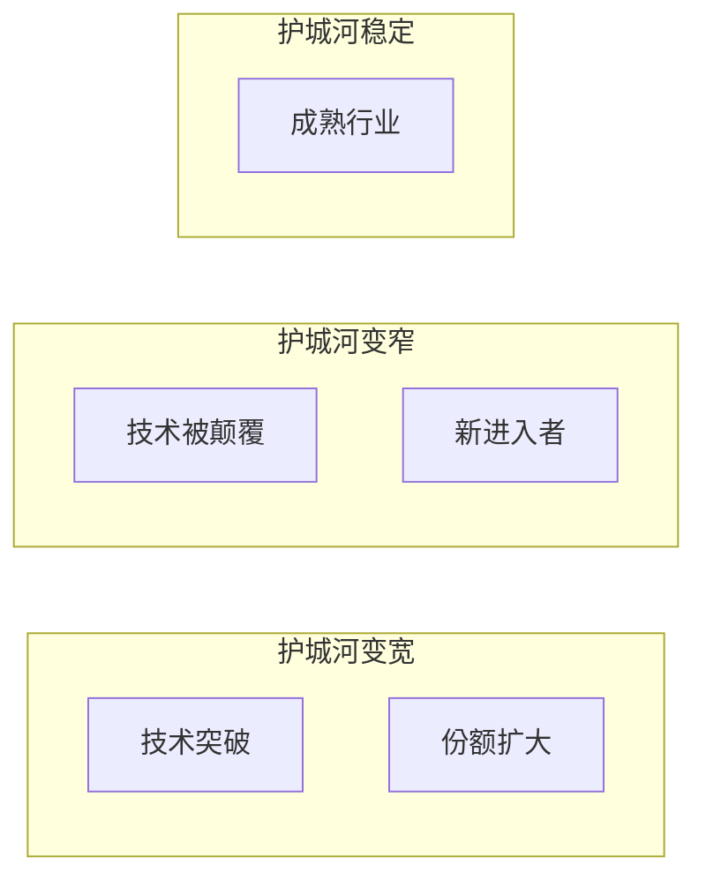

# 护城河评估

## 评估框架（晨星护城河评级 + 费雪成长股原则）

### 护城河五大来源

| 来源 | 定义 | 典型例子 | 可持续性 |
|------|------|---------|---------|
| 成本优势 | 比同行更低成本生产 | 规模效应、地理位置 | 中-高 |
| 无形资产 | 品牌、专利、牌照 | 技术专利、 regulatory capture | 高 |
| 转换成本 | 客户切换供应商成本高 | 嵌入式设计、认证流程 | 高 |
| 网络效应 | 用户越多价值越大 | 平台、标准制定者 | 极高 |
| 规模效应 | 越大越便宜 | 半导体制造、云计算 | 中 |

### 评级标准

| 评级 | 定义 | 预期超额收益持续时间 |
|------|------|---------------------|
| 宽护城河 | 多种护城河叠加，极难被颠覆 | >20年 |
| 窄护城河 | 单一护城河，有一定保护 | 10-20年 |
| 无护城河 | 无显著竞争优势 | <10年 |

## 核心标的护城河评估

### [公司A]

| 维度 | 评估 | 证据 |
|------|------|------|
| 成本优势 | [强/中/弱/无] | [证据] |
| 无形资产 | [强/中/弱/无] | [证据] |
| 转换成本 | [强/中/弱/无] | [证据] |
| 网络效应 | [强/中/弱/无] | [证据] |
| 规模效应 | [强/中/弱/无] | [证据] |
| **综合评级** | **[宽/窄/无]** | **理由** |

### [公司B]
[同上结构]

## 护城河变化趋势

[判断每家公司的护城河是在变宽、变窄还是稳定]

## 费雪成长股原则检查

| 原则 | 公司A | 公司B | 公司C |
|------|-------|-------|-------|
| 现有产品市场潜力大 | [✓/✗] | [✓/✗] | [✓/✗] |
| 决心持续研发 | [✓/✗] | [✓/✗] | [✓/✗] |
| 研发转化效率高 | [✓/✗] | [✓/✗] | [✓/✗] |
| 高于同行的销售组织 | [✓/✗] | [✓/✗] | [✓/✗] |
| 可观的利润率 | [✓/✗] | [✓/✗] | [✓/✗] |
| 成本分析和控制 | [✓/✗] | [✓/✗] | [✓/✗] |
| 人事关系良好 | [✓/✗] | [✓/✗] | [✓/✗] |
| 诚信可靠的管理层 | [✓/✗] | [✓/✗] | [✓/✗] |
| 行业竞争优势 | [✓/✗] | [✓/✗] | [✓/✗] |
| 利润未来增长点 | [✓/✗] | [✓/✗] | [✓/✗] |
| 融资需求低 | [✓/✗] | [✓/✗] | [✓/✗] |
| 报喜不报忧少 | [✓/✗] | [✓/✗] | [✓/✗] |
| 管理层言行一致 | [✓/✗] | [✓/✗] | [✓/✗] |
| 懂行的管理层 | [✓/✗] | [✓/✗] | [✓/✗] |
| 无强制劳动/治理问题 | [✓/✗] | [✓/✗] | [✓/✗] |

<!-- AI-PROMPT: 护城河评估必须有具体证据支撑，不能凭感觉。费雪原则15条是检查清单，不要求全部满足，但满足的越多越优秀。 -->