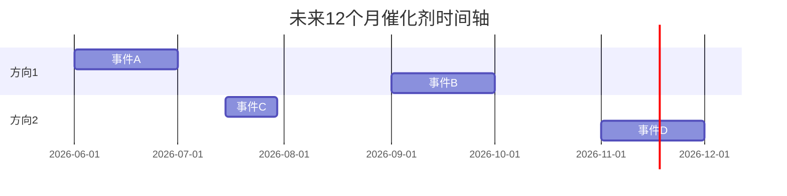

# 催化剂日历

## 时间轴总览

## 近期催化剂（0-3个月）

| 日期 | 事件 | 涉及标的 | 预期影响 | 置信度 | 已Price-in程度 |
|------|------|---------|---------|--------|---------------|
| [日期] | [事件] | [标的] | [涨跌] | [高/中/低] | [已/部分/未] |

## 中期催化剂（3-6个月）

| 日期 | 事件 | 涉及标的 | 预期影响 | 置信度 | 已Price-in程度 |
|------|------|---------|---------|--------|---------------|
| [日期] | [事件] | [标的] | [涨跌] | [高/中/低] | [已/部分/未] |

## 远期催化剂（6-12个月）

| 日期 | 事件 | 涉及标的 | 预期影响 | 置信度 | 已Price-in程度 |
|------|------|---------|---------|--------|---------------|
| [日期] | [事件] | [标的] | [涨跌] | [高/中/低] | [已/部分/未] |

## 黑天鹅/灰犀牛事件

[低概率但高影响的事件，需要持续监控]

| 事件 | 概率 | 影响方向 | 影响幅度 | 预警信号 |
|------|------|---------|---------|---------|
| [事件] | [低/中] | [正/负] | [大幅/巨震] | [信号] |

## 催化剂密度分析

[哪些月份催化剂最密集？哪些方向在特定时间段有事件集群？]

<!-- AI-PROMPT: 催化剂必须有具体日期或时间窗口。必须评估"已Price-in程度"——如果市场已经充分预期，事件落地反而可能是卖出时机。 -->