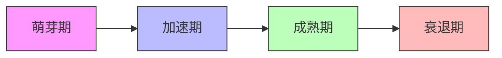
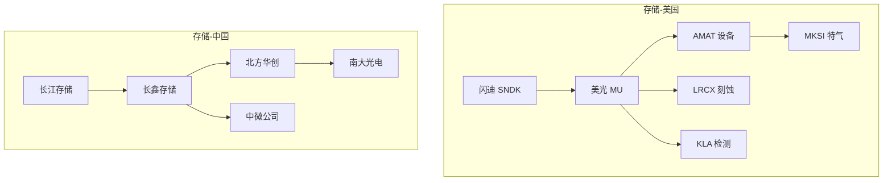

# 孙哥方向产业链全景梳理与铲子股挖掘

**深度研究报告（L3）** | **生成日期**：2026-05-15 | **版本**：v2.0 | **分析师**：AI/人机协作

---

## 免责声明

本报告由AI辅助生成，仅供参考，不构成投资建议。文中涉及的所有标的均基于公开信息整理，投资有风险，决策需独立判断。数据截至2026年5月15日。

---

## 目录

1. [市场情绪分析](#1-市场情绪分析)
2. [市场环境扫描](#2-市场环境扫描)
3. [核心投资哲学](#3-核心投资哲学)
4. [产业链全景拆解](#4-产业链全景拆解)
5. [铲子股筛选框架](#5-铲子股筛选框架)
6. [护城河评估](#6-护城河评估)
7. [催化剂日历](#7-催化剂日历)
8. [中美对比矩阵](#8-中美对比矩阵)
9. [风险矩阵与对冲](#9-风险矩阵与对冲)
10. [投资组合建议](#10-投资组合建议)
11. [实操指南](#11-实操指南)
12. [动态跟踪机制](#12-动态跟踪机制)
13. [预测与实际对比](#13-预测与实际对比)
14. [附录](#14-附录)

---

## 1. 市场情绪分析

### 1.1 情绪温度计

| 指标 | 当前值 | 区间 | 信号 |
|------|--------|------|------|
| VIX（恐慌指数） | 偏低 | 0-100 | 中性偏贪婪 |
| CNN恐惧贪婪指数 | 偏贪婪 | 0-100 | 贪婪 |
| put/call ratio | 偏低 | <0.7贪婪 / >1.2恐惧 | 贪婪 |
| AI/机器人概念资金流入 | 强劲 | — | 贪婪 |

### 1.2 板块情绪轮动

| 方向 | 情绪状态 | 资金流入 | 媒体热度 | 散户关注度 |
|------|---------|---------|---------|-----------|
| 存储 | 极度贪婪 | 强劲流入 | 极高 | 极高 |
| 具身智能/机器人 | 贪婪 | 强劲流入 | 高 | 高 |
| 无人机 | 贪婪 | 流入 | 中高 | 中 |
| 空间计算 | 中性 | 平稳 | 中 | 低 |
| 太空探索 | 贪婪 | 流入 | 高 | 中 |
| 能源 | 中性偏贪婪 | 流入 | 中 | 中 |

### 1.3 情绪与价格背离

**潜在背离机会**：空间计算板块情绪相对低迷（散户关注度低），但Vision Pro生态建设和英伟达Cosmos平台推进可能在2026年下半年引发重估。当前可能是逆向布局窗口。

### 1.4 情绪判断结论

> **当前市场整体情绪**：贪婪
> **对主题的影响**：情绪助推存储和机器人方向，但需警惕短期过热；空间计算可能被低估
> **操作建议**：对存储方向保持谨慎追高，对空间计算可逆向加仓

---

## 2. 市场环境扫描

### 2.1 宏观流动性

| 指标 | 当前值 | 趋势 | 对主题影响 |
|------|--------|------|-----------|
| 美联储利率 | 观望 | 稳定 | 中性，利于成长股 |
| 美元指数 | 偏强 | 震荡 | 对美元计价资产中性 |
| 10Y美债收益率 | 中等 | 下行 | 利好科技股估值 |
| 中国LPR | 宽松 | 下行 | 利好制造业融资 |

### 2.2 政策与监管

**美国**：
- 对华半导体出口管制持续收紧，利好本土设备和材料企业
- 国防预算增长利好无人机/Physical AI军事应用
- SpaceX IPO监管框架逐步清晰

**中国**：
- 科创板支持硬科技上市（宇树科技IPO申请）
- 低空经济政策放开利好无人机民用场景
- 新能源政策持续加码

### 2.3 技术周期位置



| 方向 | 当前阶段 | 判断依据 |
|------|---------|---------|
| 存储 | 加速期 | HBM供不应求，产能排到2028年 |
| 具身智能 | 萌芽期→加速期 | VLA模型刚成熟，量产刚开始 |
| 无人机 | 加速期 | 军事和民用均已商业闭环 |
| 空间计算 | 萌芽期 | Vision Pro刚发布，生态早期 |
| 太空探索 | 萌芽期→加速期 | SpaceX即将IPO，商业化加速 |
| 能源 | 加速期 | 核电复兴，储能规模化 |

---

## 3. 核心投资哲学

### 3.1 主题选择逻辑

**为什么是现在？**
孙宇晨于2025年11月6日提出"短期缺芯片，长期缺能源，永远缺存储"，资本市场在2026年才充分反应。2026年初，孙宇晨进一步将口径扩展至具身智能、无人机、空间计算、太空探索。这些方向正处于从"叙事验证"到"商业兑现"的关键拐点。

**为什么是这些方向？**
这些方向的共同特征是：**Physical AI** —— AI从数字世界走向物理世界。存储是数据基础设施，具身智能和无人机是执行终端，空间计算是感知层，太空是终极物理边界，能源是一切的基础。

**为什么能赚到钱？**
孙哥的历史战绩（2016年推荐比特币、英伟达、特斯拉，十年回报惊人）证明其在二级市场的方向判断具有显著超额收益。更重要的是，其投资框架（两端布局、身体与大脑分开押）降低了单一公司执行风险。

### 3.2 布局框架：两端押注

| 维度 | 身体（执行层） | 大脑（决策层） |
|------|---------------|---------------|
| 角色 | 硬件制造、量产能力 | AI芯片、算法、模型 |
| 机器人 | 特斯拉 Optimus | 英伟达 Jetson Thor |
| 无人机 | AeroVironment Switchblade | AI飞控/导航系统 |
| 风险点 | 量产不及预期 | 技术路线被颠覆 |
| 投资逻辑 | 赛道跑通就收过路费 | 卖铲子的永远赚钱 |

### 3.3 时间维度框架

| 时间维度 | 核心判断 | 代表方向 | 持有周期 |
|---------|---------|---------|---------|
| 短期（0-1年） | 存储概念过热，但基本面支撑 | 存储 | 波段操作 |
| 中期（1-3年） | 具身智能量产爬坡，无人机放量 | 机器人、无人机 | 1-3年 |
| 长期（3-10年） | 太空商业化、能源结构转型 | 太空、能源 | 3-5年 |
| 永远 | 数据增长无上限 | 存储 | 长期持有 |

### 3.4 核心假设清单

| # | 核心假设 | 置信度 | 验证方式 | 证伪信号 |
|---|---------|--------|---------|---------|
| 1 | AI算力需求持续增长 | 高 | 英伟达/CSP Capex数据 | 连续两季Capex下滑 |
| 2 | 人形机器人量产可行 | 中 | 特斯拉Optimus产量数据 | 2027年仍无法量产 |
| 3 | 无人机军事需求不可逆 | 高 | 美军采购预算 | 大规模停战协议 |
| 4 | SpaceX IPO带动太空板块 | 中 | SEC文件进展 | IPO推迟或取消 |

### 3.5 可证伪性声明

> **什么情况下我们会承认错了？**
> 1. 若2027年Optimus仍未实现年产10万台，机器人叙事的可信度将大幅下降
> 2. 若HBM产能2027年出现过剩（而非继续紧缺），存储超级周期判断错误
> 3. 若AI Capex连续两个季度下滑超过20%，整个Physical AI主题面临重估

---

## 4. 产业链全景拆解

### 4.1 存储 — "永远缺存储"

#### 美国篇

**一阶（终端产品）**

| 公司 | 股票代码 | 上市状态 | 核心产品 | 技术路线 |
|------|---------|---------|---------|---------|
| 闪迪 | SNDK | 上市 | SSD、闪存 | 3D NAND |
| 美光 | MU | 上市 | DRAM、NAND、HBM | HBM3E、1β制程 |
| 西部数据 | WDC | 上市 | HDD、SSD | 叠瓦式磁记录 |

**二阶（核心制造）**

| 公司 | 股票代码 | 上市状态 | 角色 | 产能状态 |
|------|---------|---------|------|---------|
| 美光晶圆厂 | — | 上市（MU） | IDM制造 | HBM产能紧张 |
| Intel代工 | INTC | 上市 | 外部代工 | 积极扩产 |

**三阶（铲子股 — 设备/材料/测试）**

| 公司 | 股票代码 | 上市状态 | 产品 | 护城河 |
|------|---------|---------|------|--------|
| 应用材料 | AMAT | 上市 | 沉积/刻蚀/检测 | 宽：多产品平台 |
| 拉姆研究 | LRCX | 上市 | 刻蚀设备 | 宽：技术领先 |
| 科磊 | KLA | 上市 | 检测设备 | 宽：市占率极高 |
| Teradyne | TER | 上市 | 测试设备 | 窄：机器人+半导体双驱动 |

**四阶（基础设施）**

| 公司 | 股票代码 | 上市状态 | 服务 | 周期 |
|------|---------|---------|------|------|
| MKS仪器 | MKSI | 上市 | 特种气体/真空 | 长期 |
| Entegris | ENTG | 上市 | 材料纯化 | 长期 |

**技术路线图**

```
2024 — HBM3E量产
2025 — HBM3E大规模出货
2026 — HBM4研发完成
2027 — HBM4量产
2028 — HBM4E/下一代架构
2030+ — 存算一体/新型存储
```

#### 中国篇

| 层级 | 代表公司 | 上市状态 | 股票代码 | 备注 |
|------|---------|---------|---------|------|
| 一阶 | 长江存储 | 未上市 | — | 国产NAND龙头 |
| 一阶 | 长鑫存储 | 未上市 | — | 国产DRAM |
| 三阶 | 北方华创 | 上市 | 002371.SZ | 国产设备 |
| 三阶 | 中微公司 | 上市 | 688012.SS | 刻蚀设备 |
| 三阶 | 拓荆科技 | 上市 | 688072.SS | 薄膜沉积 |
| 四阶 | 南大光电 | 上市 | 300346.SZ | 电子特气 |

#### 产业链图谱



---

### 4.2 具身智能/人形机器人 — "身体与大脑分开押"

#### 美国篇

**一阶（终端产品）**

| 公司 | 股票代码 | 上市状态 | 产品 | 进展 |
|------|---------|---------|------|------|
| 特斯拉 | TSLA | 上市 | Optimus | Gen3产线2026夏季启动，目标年产百万台 |
| Figure AI | — | 未上市 | 人形机器人 | 初创阶段 |
| Agility | — | 未上市 | Digit | 仓库场景 |
| 波士顿动力 | — | 未上市（现代旗下） | Atlas | 研发阶段 |

**二阶（核心系统）**

| 公司 | 股票代码 | 上市状态 | 系统 | 角色 |
|------|---------|---------|------|------|
| 英伟达 | NVDA | 上市 | Jetson Thor | 机器人大脑 |
| 英伟达 | NVDA | 上市 | Isaac GR00T | 通用底座 |
| 特斯拉 | TSLA | 上市 | FSD | 视觉导航 |

**三阶（铲子股）**

| 公司 | 股票代码 | 上市状态 | 产品 | 逻辑 |
|------|---------|---------|------|------|
| 英伟达 | NVDA | 上市 | AI芯片 | 大脑层，赛道跑通收过路费 |
| 高通 | QCOM | 上市 | 边缘AI芯片 | 低功耗场景 |
| Synaptics | SYNA | 上市 | 人机交互 | 传感器融合 |
| Harmonic Drive | — | 未上市（日本） | 谐波减速器 | 精密传动 |

**四阶（基础设施）**

| 类别 | 代表 | 说明 |
|------|------|------|
| 精密加工 | — | 五轴机床、磨床 |
| 特种合金 | — | 钛合金、碳纤维 |
| 仿真软件 | — | 数字孪生、物理仿真 |

#### 中国篇

| 层级 | 代表公司 | 上市状态 | 股票代码 | 备注 |
|------|---------|---------|---------|------|
| 一阶 | 宇树科技 | IPO申请中 | — | 2025年出货5500台，全球第一 |
| 一阶 | 智元机器人 | 未上市 | — | 华为系背景 |
| 一阶 | 银河通用 | 未上市 | — | 累计融资约8亿美元 |
| 一阶 | 优必选 | 上市 | 9880.HK | 港股机器人第一股 |
| 三阶 | 绿的谐波 | 上市 | 688017.SS | 谐波减速器 |
| 三阶 | 双环传动 | 上市 | 002472.SZ | RV减速器 |
| 三阶 | 恒立液压 | 上市 | 601100.SS | 丝杠 |
| 三阶 | 鸣志电器 | 上市 | 603728.SS | 电机 |
| 三阶 | 三花智控 | 上市 | 002050.SZ | 执行器 |
| 三阶 | 拓普集团 | 上市 | 601689.SS | 执行器 |
| 三阶 | 柯力传感 | 上市 | 603662.SS | 传感器 |
| 三阶 | 瑞芯微 | 上市 | 603893.SS | 机器人芯片 |

---

### 4.3 无人机/Physical AI — "AI在物理世界第一个跑通商业闭环的形态"

#### 美国篇

**一阶（终端产品）**

| 公司 | 股票代码 | 上市状态 | 产品 | 场景 |
|------|---------|---------|------|------|
| AeroVironment | AVAV | 上市 | Switchblade | 军事游荡弹药 |
| Kratos | KTOS | 上市 | XQ-58 Valkyrie | 忠诚僚机 |
| Insitu（波音） | BA | 上市 | ScanEagle | 侦察 |

**二阶（核心系统）**

| 公司 | 股票代码 | 上市状态 | 系统 | 说明 |
|------|---------|---------|------|------|
| 英伟达 | NVDA | 上市 | Jetson | 边缘AI |
| Palantir | PLTR | 上市 | AIP | 战场智能 |
| Anduril | — | 未上市 | Lattice | 自主指挥 |

**三阶（铲子股）**

| 公司 | 股票代码 | 上市状态 | 产品 | 逻辑 |
|------|---------|---------|------|------|
| Kratos | KTOS | 上市 | 无人机平台 | 单价不到五代机零头 |
| AeroVironment | AVAV | 上市 | 游荡弹药 | 39亿美元订单锁定三年 |
| 通用原子 | — | 未上市 | MQ-9 Reaper | 军用无人机龙头 |

#### 中国篇

| 层级 | 代表公司 | 上市状态 | 股票代码 | 备注 |
|------|---------|---------|---------|------|
| 一阶 | 大疆 | 未上市 | — | 全球民用无人机70%市占率 |
| 一阶 | 美团 | 上市 | 3690.HK | 无人机外卖试点 |
| 一阶 | 极飞科技 | 未上市 | — | 农业无人机 |
| 三阶 | 航天彩虹 | 上市 | 002389.SZ | 军用无人机 |
| 三阶 | 中无人机 | 上市 | 688297.SS | 翼龙系列 |

---

### 4.4 空间计算 — "让AI从理解文字过渡到理解世界"

#### 美国篇

**一阶（终端产品）**

| 公司 | 股票代码 | 上市状态 | 产品 | 说明 |
|------|---------|---------|------|------|
| 苹果 | AAPL | 上市 | Vision Pro | 空间计算旗舰 |
| Meta | META | 上市 | Quest系列 | VR/AR生态 |
| Magic Leap | — | 未上市 | ML2 | 企业AR |

**二阶（核心系统）**

| 公司 | 股票代码 | 上市状态 | 系统 | 说明 |
|------|---------|---------|------|------|
| 英伟达 | NVDA | 上市 | Cosmos | 物理世界理解平台 |
| 谷歌 | GOOGL | 上市 | Genie 3 | 世界模型 |
| 特斯拉 | TSLA | 上市 | FSD | 空间感知 |

**三阶（铲子股）**

| 公司 | 股票代码 | 上市状态 | 产品 | 逻辑 |
|------|---------|---------|------|------|
| 索尼 | SONY | 上市 | Micro OLED | Vision Pro屏幕供应商 |
| 京东方 | BOE | 上市 | 000725.SZ | 国产Micro OLED |
| 水晶光电 | — | 上市 | 002273.SZ | 光学模组 |
| 歌尔股份 | — | 上市 | 002241.SZ | 代工+光学 |
| 高通 | QCOM | 上市 | XR芯片 | 平台级芯片 |

---

### 4.5 太空探索 — "地球太小了，是我们的家"

#### 美国篇

**一阶（终端服务）**

| 公司 | 股票代码 | 上市状态 | 服务 | 说明 |
|------|---------|---------|------|------|
| SpaceX | — | 未上市 | 发射+星链 | IPO草案已递交SEC |
| Rocket Lab | RKLB | 上市 | 小型发射 | 2026Q1营收破2亿美元 |
| Planet Labs | PL | 上市 | 卫星遥感 | 地球观测 |

**二阶（核心系统）**

| 公司 | 股票代码 | 上市状态 | 系统 | 说明 |
|------|---------|---------|------|------|
| 蓝色起源 | — | 未上市 | 新谢泼德/新格伦 | 贝索斯旗下 |
| ULA | — | 未上市 | Atlas V/Vulcan | 波音+洛马合资 |

**三阶（铲子股）**

| 公司 | 股票代码 | 上市状态 | 产品 | 逻辑 |
|------|---------|---------|------|------|
| Rocket Lab | RKLB | 上市 | 火箭+卫星 | SpaceX最佳替代标的 |
| Redwire | RDW | 上市 | 卫星组件 | 太空基础设施 |
| Intuitive Machines | LUNR | 上市 | 月球着陆器 | 月球经济 |
| AST SpaceMobile | ASTS | 上市 | 卫星直连手机 | 太空通信 |

#### 中国篇

| 层级 | 代表公司 | 上市状态 | 股票代码 | 备注 |
|------|---------|---------|---------|------|
| 一阶 | 中国卫星 | 上市 | 600118.SS | 卫星制造 |
| 一阶 | 北斗星通 | 上市 | 002151.SZ | 导航系统 |
| 一阶 | 银河航天 | 未上市 | — | 卫星互联网 |
| 三阶 | 航天电子 | 上市 | 600879.SS | 航天电子 |

---

### 4.6 能源 — "长期缺能源"

#### 美国篇

**一阶（终端应用）**

| 公司 | 股票代码 | 上市状态 | 产品 | 说明 |
|------|---------|---------|------|------|
| Constellation | CEG | 上市 | 核电运营 | 美国最大核电运营商 |
| NextEra | NEE | 上市 | 风光+储能 | 清洁能源龙头 |

**二阶（核心技术）**

| 公司 | 股票代码 | 上市状态 | 技术 | 说明 |
|------|---------|---------|------|------|
| OKLO | OKLO | 上市 | SMR | 小型模块化反应堆 |
| NuScale | SMR | 上市 | SMR | 核电技术 |
| QuantumScape | QS | 上市 | 固态电池 | 下一代储能 |

**三阶（铲子股）**

| 公司 | 股票代码 | 上市状态 | 产品 | 逻辑 |
|------|---------|---------|------|------|
| Cameco | CCJ | 上市 | 铀矿 | 核电燃料 |
| Cameco + 铀矿ETF | URA | 上市 | 铀矿组合 | 核电复兴受益者 |
| Fluence | FLNC | 上市 | 储能系统 | 电网级储能 |
| Quanta | PWR | 上市 | 电网建设 | 电网升级需求 |
| Eaton | ETN | 上市 | 电气设备 | 输配电设备 |

#### 中国篇

| 层级 | 代表公司 | 上市状态 | 股票代码 | 备注 |
|------|---------|---------|---------|------|
| 一阶 | 中国核电 | 上市 | 601985.SS | 核电运营 |
| 一阶 | 长江电力 | 上市 | 600900.SS | 水电龙头 |
| 三阶 | 宁德时代 | 上市 | 300750.SZ | 动力电池 |
| 三阶 | 隆基绿能 | 上市 | 601012.SS | 光伏组件 |
| 三阶 | 阳光电源 | 上市 | 300274.SZ | 逆变器 |
| 三阶 | 国电南瑞 | 上市 | 600406.SS | 电网自动化 |
| 四阶 | 特变电工 | 上市 | 600089.SS | 特高压设备 |

---

## 5. 铲子股筛选框架

### 5.1 筛选漏斗

```
全部候选标的（100+）
    → 基本面筛选（50）
    → 估值筛选（20）
    → 护城河筛选（10）
    → 催化剂匹配（5-8）
```

### 5.2 最终铲子股清单

| 排名 | 公司 | 代码 | 上市状态 | 方向 | 核心逻辑 | 目标价 | 止损价 | 仓位 |
|------|------|------|---------|------|---------|--------|--------|------|
| 1 | 应用材料 | AMAT | 上市 | 存储 | 半导体设备寡头，HBM扩产直接受益 | 待定 | 待定 | 15% |
| 2 | 英伟达 | NVDA | 上市 | 机器人/空间计算 | AI基础设施，多方向铲子 | 待定 | 待定 | 15% |
| 3 | Kratos | KTOS | 上市 | 无人机 | 忠诚僚机放量，F-35配套 | 待定 | 待定 | 10% |
| 4 | Rocket Lab | RKLB | 上市 | 太空 | SpaceX替代标的，商业化验证 | 待定 | 待定 | 10% |
| 5 | Cameco | CCJ | 上市 | 能源 | 核电复兴，铀矿龙头 | 待定 | 待定 | 10% |
| 6 | 北方华创 | 002371.SZ | 上市 | 存储（中国） | 国产设备替代 | 待定 | 待定 | 10% |
| 7 | 绿的谐波 | 688017.SS | 上市 | 机器人（中国） | 减速器国产替代 | 待定 | 待定 | 10% |
| 8 | 三花智控 | 002050.SZ | 上市 | 机器人（中国） | 执行器，特斯拉供应链 | 待定 | 待定 | 10% |

### 5.3 排除清单

| 公司 | 排除原因 | 重新考虑条件 |
|------|---------|-------------|
| 闪迪 SNDK | 涨幅过大，情绪过热 | PE回落至历史均值 |
| 特斯拉 TSLA | 主业估值已含机器人预期 | Optimus量产数据验证 |
| SpaceX | 未上市，无法直接投资 | IPO后评估 |

---

## 6. 护城河评估

### 核心标的护城河评级

| 公司 | 成本优势 | 无形资产 | 转换成本 | 网络效应 | 规模效应 | **综合评级** |
|------|---------|---------|---------|---------|---------|-------------|
| 英伟达 NVDA | 中 | 强（CUDA） | 强 | 强（生态） | 强 | **宽** |
| 应用材料 AMAT | 中 | 强（专利） | 强 | 弱 | 强 | **宽** |
| 台积电 TSM | 强 | 强（工艺） | 极强 | 弱 | 极强 | **宽** |
| Kratos KTOS | 弱 | 中（军工资质） | 中 | 弱 | 弱 | **窄** |
| Rocket Lab RKLB | 中 | 中 | 中 | 弱 | 中 | **窄** |
| 北方华创 | 中 | 中（国产替代） | 中 | 弱 | 中 | **窄** |

---

## 7. 催化剂日历

### 近期（0-3个月）

| 日期 | 事件 | 涉及标的 | 预期影响 | 置信度 | Price-in |
|------|------|---------|---------|--------|----------|
| 2026-06 | 特斯拉Optimus Gen3产线启动 | TSLA | 正向 | 高 | 部分 |
| 2026-06 | 宇树科技科创板IPO审核 | 宇树（未上市） | 正向 | 中 | 未 |
| 2026-07 | 英伟达GTC回顾/新品发布 | NVDA | 正向 | 高 | 部分 |

### 中期（3-6个月）

| 日期 | 事件 | 涉及标的 | 预期影响 | 置信度 | Price-in |
|------|------|---------|---------|--------|----------|
| 2026-09 | SpaceX IPO SEC反馈 | RKLB | 正向 | 中 | 部分 |
| 2026-10 | HBM4技术细节公布 | MU/SNDK/AMAT | 正向 | 高 | 未 |

### 远期（6-12个月）

| 日期 | 事件 | 涉及标的 | 预期影响 | 置信度 | Price-in |
|------|------|---------|---------|--------|----------|
| 2027-Q1 | HBM4量产爬坡 | MU/SNDK/AMAT/LRCX | 正向 | 高 | 未 |
| 2027 | 人形机器人首批量产交付 | TSLA/绿的谐波 | 正向 | 中 | 部分 |

---

## 8. 中美对比矩阵

### 综合评分（1-10分制）

| 维度 | 美国 | 中国 | 差距 | 领先方 |
|------|------|------|------|--------|
| 技术领先性 | 8 | 6 | 2 | 美国 |
| 成本制造 | 5 | 8 | -3 | 中国 |
| 市场规模 | 6 | 8 | -2 | 中国 |
| 政策支持 | 5 | 7 | -2 | 中国 |
| 资本深度 | 8 | 6 | 2 | 美国 |
| 人才储备 | 7 | 7 | 0 | 持平 |
| 供应链安全 | 6 | 7 | -1 | 中国 |

### 方向级对比

| 方向 | 美国优势 | 中国优势 | 投资策略 |
|------|---------|---------|---------|
| 存储 | 设备、HBM技术 | 制造产能、成本 | 美国买设备，中国看替代 |
| 机器人 | AI芯片、VLA模型 | 制造、供应链 | 两端布局 |
| 无人机 | 军事AI、高端 | 民用制造、成本 | 美国买军事，中国看大疆映射 |
| 空间计算 | 平台、芯片 | 光学、代工 | 美国买平台，中国买光学 |
| 太空 | 发射、卫星互联网 | 国家工程 | 美国买商业太空 |
| 能源 | 核电技术、SMR | 光伏、储能、电网 | 美国买铀/核电，中国买储能/电网 |

---

## 9. 风险矩阵与对冲

### 主要风险

| 风险 | 概率 | 影响 | 涉及标的 | 预警信号 |
|------|------|------|---------|---------|
| AI Capex周期见顶 | 中 | 高 | NVDA/AMAT/TSLA | 云厂商Capex连续两季下滑 |
| 地缘制裁升级 | 中 | 高 | 中美科技全链条 | 新出口管制清单 |
| 机器人量产不及预期 | 中 | 中 | TSLA/机器人供应链 | 产量数据低于目标50% |
| 存储周期反转 | 低 | 高 | MU/SNDK/AMAT | HBM库存周转天数上升 |
| SpaceX IPO推迟 | 中 | 中 | RKLB/太空板块 | SEC反馈延迟 |

### "如果孙哥错了"风险

| 孙哥判断 | 证伪场景 | 影响标的 | 损失评估 |
|---------|---------|---------|---------|
| "永远缺存储" | HBM产能过剩、新技术替代 | MU/SNDK/AMAT | 最大回撤30-50% |
| "AI到达iPhone时刻" | AI应用渗透率停滞 | NVDA/TSLA/全链条 | 最大回撤40-60% |
| "机器人百万台量产" | 2027年仍无法量产 | TSLA/机器人供应链 | 最大回撤20-30% |

### 对冲方案

| 工具 | 标的 | 比例 | 成本 | 触发条件 |
|------|------|------|------|---------|
| 持有现金 | 现金 | 10% | 机会成本 | always |
| 买入看跌期权 | QQQ/SPY Put | 2-3%权利金 | 权利金 | 指数跌破关键支撑 |
| 跨市场配置 | 中国国债/黄金 | 10% | — | 美股过热 |
| 反向ETF | SQQQ | 5% | 管理费 | 纳斯达克跌幅>15% |

### 压力测试

| 极端情景 | 组合损失 | 最大回撤 | 恢复时间 |
|---------|---------|---------|---------|
| 2022式科技崩盘 | -35% | -40% | 12-18个月 |
| 2018式贸易战 | -20% | -25% | 6-9个月 |
| AI叙事破裂 | -45% | -50% | 18-24个月 |

---

## 10. 投资组合建议

### 美国组合

**核心仓位（60%）**

| 标的 | 代码 | 权重 | 逻辑 | 目标价 | 止损价 |
|------|------|------|------|--------|--------|
| 英伟达 | NVDA | 20% | AI基础设施，多方向铲子 | 待定 | 待定 |
| 应用材料 | AMAT | 20% | 半导体设备寡头 | 待定 | 待定 |
| 特斯拉 | TSLA | 20% | Optimus身体层龙头 | 待定 | 待定 |

**卫星仓位（30%）**

| 标的 | 代码 | 权重 | 逻辑 |
|------|------|------|------|
| Kratos | KTOS | 10% | 军事无人机放量 |
| Rocket Lab | RKLB | 10% | 太空商业化替代标的 |
| Cameco | CCJ | 10% | 核电复兴铀矿 |

**现金/对冲（10%）**

### 中国组合

**核心仓位（50%）**

| 标的 | 代码 | 权重 | 逻辑 |
|------|------|------|------|
| 北方华创 | 002371.SZ | 20% | 国产设备替代 |
| 宁德时代 | 300750.SZ | 15% | 储能龙头 |
| 阳光电源 | 300274.SZ | 15% | 逆变器出海 |

**卫星仓位（40%）**

| 标的 | 代码 | 权重 | 逻辑 |
|------|------|------|------|
| 绿的谐波 | 688017.SS | 10% | 减速器 |
| 三花智控 | 002050.SZ | 10% | 执行器 |
| 国电南瑞 | 600406.SS | 10% | 电网自动化 |
| 中无人机 | 688297.SS | 10% | 军用无人机 |

**现金/对冲（10%）**

### 观察名单

| 标的 | 状态 | 等待条件 | 预计时间 |
|------|------|---------|---------|
| SpaceX | 未上市 | IPO后评估 | 2026-2027 |
| 宇树科技 | IPO申请中 | 上市后观察 | 2026 |
| 大疆 | 未上市 | 寻找A股映射标的 | — |
| 银河通用 | 未上市 | 后续融资估值 | — |

---

## 11. 实操指南

### 开户与交易便利性

| 维度 | 美股 | A股 | 港股 |
|------|------|------|------|
| 开户门槛 | 较低（身份证+地址证明） | 低（身份证） | 中（身份证+银行卡） |
| 资金门槛 | 无 | 无 | 无 |
| 交易时间 | 21:30-04:00（北京时间） | 09:30-15:00 | 09:30-16:00 |
| 交易费用 | 低（零佣金券商） | 低（万1-万3） | 中（千1-千3） |
| 税务 | 资本利得税（非美居民免） | 股息税10% | 股息税10% |
| 出入金 | 需境外银行卡 | 便捷 | 需香港银行卡 |

### 孙哥公开持仓追踪

| 标的 | 来源 | 可信度 | 时间 | 备注 |
|------|------|--------|------|------|
| BTC | 公开言论 | 高 | 2013年起 | 持续持有 |
| 英伟达 NVDA | 公开言论 | 高 | 2016年推荐 | 十年回报约24000% |
| 特斯拉 TSLA | 公开言论 | 高 | 2016年推荐 | 十年回报约2683% |
| 腾讯 | 公开言论 | 高 | 2016年推荐 | — |

### 未上市公司替代标的

| 未上市 | 替代标的 | 替代逻辑 | 相关性 |
|--------|---------|---------|--------|
| SpaceX | Rocket Lab (RKLB) | 商业发射 | 高 |
| 大疆 | 航天彩虹 (002389.SZ) | 无人机 | 中 |
| 宇树科技 | 绿的谐波/三花智控 | 供应链 | 中高 |

---

## 12. 动态跟踪机制

### 季度复盘模板

1. **预测验证**：上季度预测了什么？实际如何？
2. **组合表现**：核心 vs 卫星仓位贡献
3. **新信息**：是否改变判断？
4. **错误记录**：犯了什么错？
5. **方法论修正**：框架是否需要调整？

### 关键指标监控

| 指标 | 频率 | 警戒线 | 行动 |
|------|------|--------|------|
| 英伟达PE | 周 | >70x | 减仓 |
| HBM产能利用率 | 季 | <80% | 警惕周期见顶 |
| 特斯拉Optimus产量 | 季 | 低于目标50% | 减仓机器人链 |
| 美联储利率 | 月 | 加息预期升温 | 增配防御 |

<!-- UPDATE-MARKER: 下次更新日期 = 2026-05-22 -->
<!-- UPDATE-MARKER: 下次回测日期 = 2026-06-30 -->

---

## 13. 预测与实际对比

### 上季度（2026-Q1）预测回顾

见 `backtest/2026-Q1-预测.md` 和 `backtest/2026-Q1-结果.md`。

**关键偏差**：
- 闪迪股价预测 $80-100，实际 $1439，大幅低估（原因：AI存储需求爆发+情绪过热）
- 方法论修正：增加情绪指标权重，扩大高波动标的预测区间

### 本季度新预测（2026-Q2）

| # | 预测项 | 预测内容 | 置信度 | 验证方式 |
|---|--------|---------|--------|---------|
| 1 | 英伟达PE | 维持60x以上 | 中 | 股价数据 |
| 2 | 特斯拉Optimus | Gen3产线按期启动 | 高 | 公司公告 |
| 3 | 无人机军事订单 | AVAV/KTOS订单继续增长 | 高 | 财报 |
| 4 | SpaceX IPO | SEC反馈正常推进 | 中 | SEC文件 |
| 5 | 存储情绪 | 短期过热，下半年可能回调 | 中 | 市场情绪指标 |

---

## 14. 附录

### 14.1 数据来源
- 公司公告、SEC文件、财报
- Bloomberg、Wind、东方财富
- 权威财经媒体

### 14.2 术语表
- **HBM**：High Bandwidth Memory，高带宽存储
- **VLA**：Vision-Language-Action，视觉-语言-动作模型
- **SMR**：Small Modular Reactor，小型模块化反应堆
- **Physical AI**：物理世界人工智能

### 14.3 免责声明
本报告由AI辅助生成，仅供参考，不构成投资建议。投资者应根据自身情况独立判断，并承担相应风险。

---

*报告完成。数据截至2026年5月15日。*

---

## 返回导航

→ 返回 [[主页]]
→ 查看 [[输出中心|其他报告]]
→ 前往 [[模板中心|生成新报告]]
