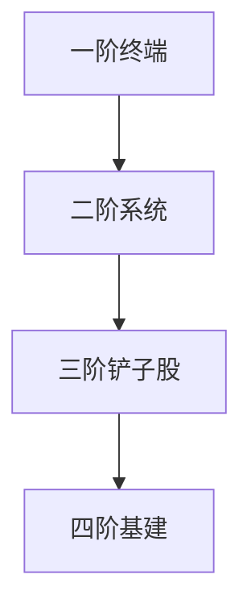

# {{theme.name}} — 投资简报

**生成日期**：{{date}} | **版本**：L2 | **分析师**：AI/人机协作

---

## 1. 核心结论（Executive Summary）

[3-5段，每段不超过3行。先说结论，再说依据。]

## 2. 投资逻辑（Investment Thesis）

### 2.1 宏观驱动
[市场环境扫描的核心发现]

### 2.2 产业趋势
[核心投资哲学的应用]

### 2.3 时机判断
[催化剂日历的近期触发点]

## 3. 产业链概览

### 3.1 方向一：[方向名]

[表格：各层级核心标的 + 上市状态 + 股票代码]

### 3.2 方向二：[方向名]
[同上结构]

## 4. 铲子股筛选清单

| 公司 | 代码 | 上市状态 | 市值 | PE | 护城河评级 | 催化剂 | 风险等级 |
|------|------|---------|------|----|-----------|--------|---------|
| [公司] | [代码] | [上市/未上市] | [$] | [PE] | [宽/窄/无] | [事件] | [高/中/低] |

## 5. 风险与对冲

### 5.1 主要风险
[风险矩阵的前三项]

### 5.2 对冲方案
[核心对冲逻辑]

## 6. 组合建议

### 6.1 核心仓位（60-70%）
[2-3个龙头标的]

### 6.2 卫星仓位（30-40%）
[4-6个铲子股]

### 6.3 现金比例
[%]

## 7. 跟踪指标

| 指标 | 当前值 | 警戒线 | 数据来源 |
|------|--------|--------|---------|
| [指标1] | [值] | [阈值] | [来源] |

---

*免责声明：本简报由AI辅助生成，不构成投资建议。*

<!-- AI-PROMPT: 控制在8-12页。每节有清晰标题，多用表格和列表，少用长段落。Mermaid图表至少1个。每个标的后标注"上市/未上市"。 -->

---

## 返回导航

→ 返回 [[主页]]
→ 选择其他深度：[[模板中心]]
→ 查看已生成报告：[[输出中心]]
