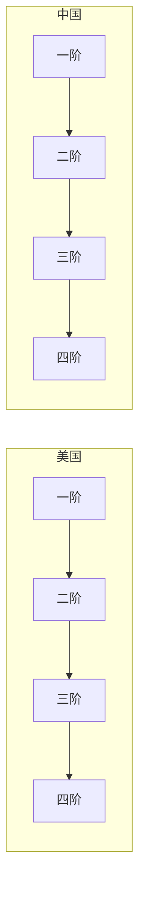

# {{theme.name}} — 深度研究报告

**生成日期**：{{date}} | **版本**：L3 | **分析师**：AI/人机协作

---

## 目录

1. [市场情绪分析](#1-市场情绪分析)
2. [市场环境扫描](#2-市场环境扫描)
3. [核心投资哲学](#3-核心投资哲学)
4. [产业链全景拆解](#4-产业链全景拆解)
5. [铲子股筛选框架](#5-铲子股筛选框架)
6. [护城河评估](#6-护城河评估)
7. [催化剂日历](#7-催化剂日历)
8. [中美对比矩阵](#8-中美对比矩阵)
9. [风险矩阵与对冲](#9-风险矩阵与对冲)
10. [投资组合建议](#10-投资组合建议)
11. [实操指南](#11-实操指南)
12. [动态跟踪机制](#12-动态跟踪机制)
13. [预测与实际对比](#13-预测与实际对比)
14. [附录](#14-附录)

---

## 1. 市场情绪分析

<!-- 插入 modules/00-市场情绪分析.md -->

## 2. 市场环境扫描

<!-- 插入 modules/01-市场环境扫描.md -->

## 3. 核心投资哲学

<!-- 插入 modules/02-核心投资哲学.md -->

## 4. 产业链全景拆解

### 4.1 [方向1] — [一句话定位]

#### 4.1.1 美国篇

**一阶（终端产品）**
[公司列表 + 上市状态 + 财务数据 + 技术路线图]

**二阶（核心系统）**
[公司列表 + 上市状态 + 财务数据 + 技术路线图]

**三阶（铲子股）**
[公司列表 + 上市状态 + 财务数据 + 技术路线图 + 估值模型]

**四阶（基础设施）**
[公司列表 + 上市状态 + 合同金额 + 建厂周期]

#### 4.1.2 中国篇
[同上结构]

#### 4.1.3 产业链图谱（Mermaid）

### 4.2 [方向2] — [一句话定位]
[同上结构]

### 4.3 [方向3] — [一句话定位]
[同上结构]

### 4.4 [方向4] — [一句话定位]
[同上结构]

### 4.5 [方向5] — [一句话定位]
[同上结构]

### 4.6 [方向6] — [一句话定位]
[同上结构]

## 5. 铲子股筛选框架

<!-- 插入 modules/04-铲子股筛选.md -->

## 6. 护城河评估

<!-- 插入 modules/05-护城河评估.md -->

## 7. 催化剂日历

<!-- 插入 modules/06-催化剂日历.md -->

## 8. 中美对比矩阵

<!-- 插入 modules/07-中美对比矩阵.md -->

## 9. 风险矩阵与对冲

<!-- 插入 modules/08-风险矩阵与对冲.md -->

## 10. 投资组合建议

<!-- 插入 modules/09-组合构建.md -->

## 11. 实操指南

<!-- 插入 modules/10-实操指南.md -->

## 12. 动态跟踪机制

<!-- 插入 modules/11-动态跟踪机制.md -->

## 13. 预测与实际对比

<!-- 插入 modules/12-预测与实际对比.md -->

## 14. 附录

### 14.1 数据来源
### 14.2 术语表
### 14.3 免责声明

---

*免责声明：本报告由AI辅助生成，仅供参考，不构成投资建议。投资有风险，决策需独立判断。*

<!-- AI-PROMPT: 这是完整深度报告模板。每个模块按对应文件填充。每个方向必须有美国篇+中国篇+产业链图谱。技术路线图用时间轴形式呈现。所有公司标注上市状态。 -->

---

## 返回导航

→ 返回 [[主页]]
→ 选择其他深度：[[模板中心]]
→ 查看已生成报告：[[输出中心]]
