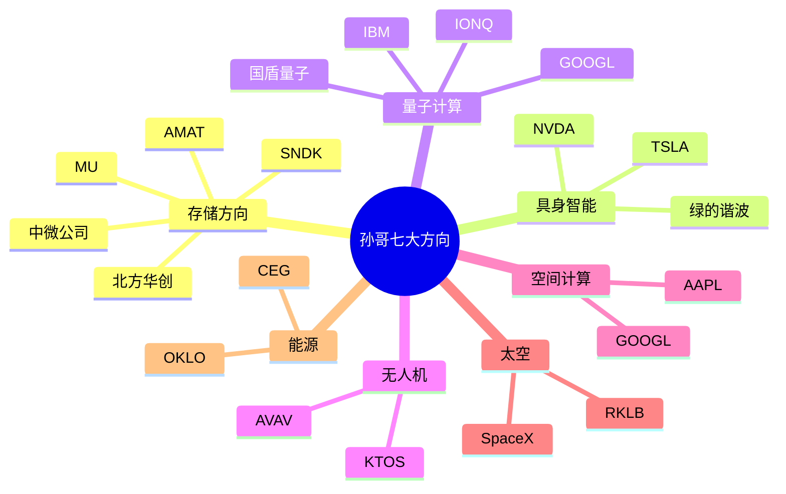

# 🏠 Investment Skill 主页

> **最后更新**：2026-05-15 | **版本**：v2.5
> 
> 这是 [[Obsidian]] 主页，包含所有双向链接。点击 `Ctrl+鼠标悬停` 可预览，点击 `Ctrl+点击` 可打开。

---

## 📊 快速入口

| 做什么 | 点击这里 |
|--------|----------|
| 查看框架结构 | [[框架指南]] |
| 查看使用手册 | [[使用与调教指南]] |
| 查看总纲 | [[SKILL]] |
| **生成新报告** | [[模板中心]] → 选择模板 → 对AI说"生成报告" |
| **查看最新报告** | [[输出中心]] |
| **更新数据** | [[数据层中心]] → 运行 [[一键更新]] |
| **验证预测** | [[回测中心]] |
| 股票完成状态 | [[core_logic/index\|深度分析索引]] |

---

## 🏛️ 五大枢纽（点击展开）

### 🔴 [[数据层中心]] — 每周更新
估值、催化剂、深度分析库

### 🟡 [[模板中心]] — 生成报告
L0-L4 模板选择

### 🟢 [[输出中心]] — 查看报告
已生成的历史报告

### 🔵 [[方法论中心]] — 分析框架
费雪原则、护城河评估、产业链拆解

### 🟣 [[回测中心]] — 验证进化
预测vs实际、错误记录、框架迭代

---

## 📁 详细目录导航

### 🔴 数据层（每周更新）
→ 前往 [[数据层中心]] 查看全部

核心文件：
- [[data/孙哥方向/valuation|估值数据]] ⭐
- [[data/孙哥方向/catalysts|催化剂日历]]
- [[data/孙哥方向/tickers|股票清单]]
- [[data/孙哥方向/etfs|ETF备选]]

### 🟡 深度分析（投资决策依据）
→ 前往 [[core_logic/index|查看所有完成状态]]

已完成：
- [[core_logic/存储方向|存储方向]] — 中微、北方华创
- [[core_logic/具身智能方向|具身智能]] — 英伟达、特斯拉、绿的谐波
- [[core_logic/量子计算方向|量子计算]] — 产业链完整分析

### 🟢 分析模块（可自由组合）
→ 前往 [[模板中心]] 选择报告深度

核心模块：
- [[modules/00-市场情绪分析|市场情绪]]
- [[modules/03-产业链拆解|产业链拆解]]
- [[modules/04-铲子股筛选|铲子股筛选]]
- [[modules/06-风险矩阵|风险矩阵]]
- [[modules/13-ETF备选与核心逻辑|ETF备选]]

### 🔵 方法论框架
→ 前往 [[方法论中心]] 查看全部

核心方法：
- [[frameworks/费雪成长股原则|费雪成长股原则]]
- [[frameworks/产业链拆解框架|产业链拆解框架]]
- [[frameworks/股票库维护规则|股票库维护规则]]

### 🟣 风格模板
→ 前往 [[方法论中心#风格选择|方法论中心]] 查看

- [[styles/专业投行风|专业投行风]]
- [[styles/口语化风|口语化风]]
- [[styles/路演PPT风|路演PPT风]]

---

## 🗺️ 方向总览



---

## ✅ 本周待办

- [ ] 运行 [[一键更新]] 检查数据新鲜度
- [ ] 更新 [[data/孙哥方向/catalysts|催化剂日历]]
- [ ] 生成本周 [[output|L2简报]]

---

## 📈 核心标的监控面板

| 标的 | 代码 | 状态 | 核心逻辑 | 当前PS |
|------|------|------|----------|--------|
| 英伟达 | NVDA | ✅ 深度完成 | 超级铲子股 | 26x |
| 中微公司 | 688012.SS | ✅ 深度完成 | 刻蚀国产替代 | 20.7x |
| 北方华创 | 002371.SZ | ✅ 深度完成 | 平台型设备 | 10.4x |
| 闪迪 | SNDK | 📝 待补充 | HBM受益 | 15.5x |
| 美光 | MU | 📝 待补充 | HBM三大原厂 | 15.1x |

*数据来自 [[data/孙哥方向/valuation|估值文件]]*

---

## 🔗 双向链接图谱

在 Obsidian 中按 `Ctrl+G` 打开图谱视图，可以看到：
- 哪些文件被链接最多（核心枢纽）
- 哪些文件孤立（需要建立连接）
- 方向之间的关联

---

## 📚 学习路径

**新手入门**：
1. 先看 [[SKILL]] 了解框架设计
2. 再看 [[框架指南]] 熟悉文件结构  
3. 查看 [[数据层中心]] 理解数据更新
4. 学习 [[方法论中心]] 掌握分析方法
5. 阅读 [[链接维护指南]] 理解链接管理

**日常操作**：
1. 周一：打开 [[数据层中心]] → 运行 [[一键更新]]
2. 检查：运行 `python check_links.py`（确保链接完整）
3. 生成：打开 [[模板中心]] → 对AI说"生成报告"
4. 修复：运行 `python generate_report.py --fix-all`
5. 查看：打开 [[输出中心]] 阅读报告

**深度研究**：
1. 打开 [[core_logic/index|深度分析索引]]
2. 选择方向 → 阅读标的分析
3. 参考 [[方法论中心]] 验证逻辑

**季度回测**：
1. 打开 [[回测中心]]
2. 对比预测vs实际
3. 记录错误，迭代方法

---

## 🎯 常用操作

| 操作 | 快捷方式 |
|------|----------|
| 检查数据新鲜度 | 双击 [[一键更新]] |
| 检查链接完整性 | 运行 `python check_links.py` |
| 查看最新报告 | 打开 [[输出中心]] |
| 选择报告模板 | 打开 [[模板中心]] |
| 更新催化剂 | 编辑 [[data/孙哥方向/catalysts\|catalysts.yaml]] |
| 查看深度分析 | 打开 [[core_logic/index\|深度分析索引]] |
| 验证预测 | 打开 [[回测中心]] |

---

## ⚠️ 维护提醒

**生成新报告后**，记得运行：
```
python generate_report.py --fix-all
```
这会自动为所有报告添加返回链接，避免孤立文件。

---

## 🔍 常用搜索

```
# 搜索未完成的深度分析
path:core_logic tag:待补充

# 搜索本周待更新
path:data 2026-05

# 搜索铲子股
tag:铲子股
```

---

> 💡 **提示**：Obsidian 的 `[[` 自动补全功能可以快速链接到任何文件。输入 `[[中微` 会自动提示 [[core_logic/存储方向#中微公司|中微公司]]。

> ⚠️ **注意**：Obsidian 不会修改你的文件结构，只是读取。你仍然可以用 VS Code、文件管理器等正常操作。

---

*本文件为 Obsidian 专用主页，双向链接语法在其他 Markdown 编辑器中会显示为普通文本。*
